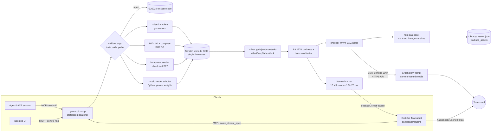

# Music, background audio and layering: technical spec (v0.1 draft)

| | |
|---|---|
| Status | Draft for DarbotLabs review. Not implemented. Written during the Gen Audio security HALT; nothing here has been pushed, committed or run against a remote. |
| Audience | DarbotLabs engineers and cloud coding agents implementing the feature |
| Intended repo path | `docs/MUSIC_GENERATION_SPEC.md`. The repo keeps design docs and specs in `docs/` (`docs/ASSET_OBJECT_MODEL.md`, `docs/PRODUCTION_COMPLETION_SPEC.md`, `docs/ARCHITECTURE.md`). There is no `specs/` directory. The scratch copy sits at `specs/` only because the brief asked for that path. |
| Repo inspected | `https://github.com/darbotlabs/gen-audio` (default branch `main`) |
| Branch / commit inspected | Local checkout `/workspace/gen-audio-cube`, branch `cursor/unified-asset-schema-autoplay`, HEAD `248ef8c97816f340b087a8b5319faba41c03b398` (2026-10-08 10:00 PDT). Read-only, no fetch. As of the last local fetch, `origin/cursor/unified-asset-schema-autoplay` was at `63ca362`, 3 commits ahead. Those commits touch sidecar path rules and README text, not audio. `origin/main` was at `3206ac8`. |
| Teams package inspected | `https://github.com/darbotlabs/plugins`, branch `gbot-teams-apppackage` (PR #3), local copy `/workspace/gbot-teams-pkg-push/repo`, HEAD `55d3065` (2026-10-19 07:45 PDT). File: `plugins/teams-agent365/appPackage/manifest.json` |
| Normative words | MUST, MUST NOT, SHOULD and MAY are used as in RFC 2119 |

> **Dependency.** This spec builds on the unified asset object model. That model
> (`docs/ASSET_OBJECT_MODEL.md`, `schemas/asset-object.schema.json`,
> `crates/gen-audio-core/src/asset.rs`, `asset_migrate.rs`) exists on
> `cursor/unified-asset-schema-autoplay`. As of the last local fetch it was **not on
> `origin/main`** (`3206ac8`). Level 1 cannot merge until that model is on `main`.

---

## 0. Inventory: what exists today (evidence)

Every row cites a file at `248ef8c`. "Absent" means `rg -i` over every tracked file
(excluding `voices/` and `artifacts/`) found nothing. It does not mean the feature is
planned somewhere else.

### 0.1 Audio generation

| Area | What exists | Evidence |
|---|---|---|
| Speech synthesis | kokoro-onnx multi-turn TTS. It calls `Kokoro.create` per turn and **concatenates** turns with `gap_s` silence (default 0.35 s). A turn at a different rate is resampled to the first turn's rate. This is concatenation, not mixing. | `src/gen_audio/synth_kokoro_onnx.py` (L62, L191, L212 `np.concatenate`), `docs/ARCHITECTURE.md` §kokoro-onnx path |
| Engine registry | A list, not a loader: `kokoro_onnx` (the only adapter), plus compare-list slots `kokoro_dayour`, `misaki` (G2P), `vibevoice`, `magpie` and `pocket_tts` (no adapter). | `src/gen_audio/engines.py`, `crates/gen-audio-core/src/engines.rs`, `docs/ARCHITECTURE.md` §Engines |
| "Adaptive voice-model framework" | No module by that name. The nearest code is the `voice_model` asset kind with `body.availability` (`ok` / `offline_only` / unavailable) plus the engine registry. | `docs/ASSET_OBJECT_MODEL.md` §4, `crates/gen-audio-core/src/asset_migrate.rs` |
| Fixture tone | Rust writes a labeled 16 kHz mono PCM16 sine (40 Hz + 440 Hz), with 80 ms of silence at each edge and a sidecar that says it is not speech. It has a hand-rolled RIFF/WAV encoder (`encode_wav`). | `crates/gen-audio-core/src/fixture.rs` L21–80; MCP tool `fixture_tone` |
| Browser test signals | 16 kHz synthetic buffers for the in-window DFT and the profile map. These are not audio output. | `apps/desktop/src/signal.ts` L9, `apps/desktop/src/profiles.ts` L101 |
| Music, instruments, noise or ambient generation | **Absent.** The only "noise" hits are the noise floor used for the `confidence` layer in cube analysis. | `src/gen_audio/cube_layers.py` L29, L145 |
| MIDI (files, devices, GM) | **Absent.** No `midi` string in any tracked file. No MIDI dependency. | `rg -i midi` → 0 hits; `Cargo.toml`, `pyproject.toml`, `apps/desktop/package.json` |
| SoundFont / SF2 | **Absent.** | `rg -i 'soundfont|sf2'` → 0 hits |
| Music-generation models | **Absent.** | `rg -i music` → 0 hits |

### 0.2 Encoding, sample rates and I/O

| Area | What exists | Evidence |
|---|---|---|
| WAV I/O (Python) | `soundfile`. `read_wav` returns **mono** float32: stereo is averaged down by `as_mono`. `write_wav` writes mono, PCM_16 by default or `FLOAT`. There is **no stereo path**. | `src/gen_audio/audio_io.py` L11–68 |
| WAV writer (Rust) | Mono PCM16 RIFF writer, fixture only. | `crates/gen-audio-core/src/fixture.rs` `encode_wav` |
| 24 kHz publish chain | `PUBLISH_SAMPLE_RATE = 24_000`, `PEAK_TARGET = 0.89`. Order: trim silence → **high-pass at 70 Hz** (Butterworth order 2, zero-phase) → peak normalize → `resample_poly` to 24 kHz. It is speech-specific. | `src/gen_audio/improve.py` L24–26, L117–139; `docs/ARCHITECTURE.md` §24 kHz publish path |
| Sample-rate identity | `audio_clip.fields.sample_rate_hz`, `duration_ms` (via `ms_from_frames`, round half up) and `channels` (1..32) come from the WAV header. `bin_frames` has a two-branch rule (`downsample_sf_st[1] × hop`, or inferred from the float `duration_s × sr / time_bins`). The 24000 Hz example (`157.134 s × 24000`) is a pinned vector. | `crates/gen-audio-core/src/asset_migrate.rs` L153–158, L219–245; `docs/ASSET_OBJECT_MODEL.md` §2 rounding table |
| Other codecs | **No FLAC, Opus or MP3 encoder or decoder.** The strings appear in `.gitignore` only. `guards.py` accepts `output_format ∈ {wav, mp3}` as a **request field** validated for the external genaid-audio proxy. It does not encode. | `.gitignore`; `src/gen_audio/guards.py` L26, L93–98 |
| Resampling | `scipy.signal.resample_poly` (Python only). | `src/gen_audio/improve.py` L117–129 |
| Loudness | Peak only (0.89 linear ≈ −1 dBFS). The cube metrics use **RMS/peak (inv-HDR)**. There is **no LUFS / BS.1770 measurement and no true-peak**. | `src/gen_audio/improve.py`, `src/gen_audio/cube_revision.py`, `docs/ARCHITECTURE.md` §Cube revision |
| Media size cap | `MAX_MEDIA_BYTES = 256 MiB`, checked in `verify_media`. | `crates/gen-audio-core/src/asset.rs` L33, L703 |

### 0.3 Mixing, layering and playback

| Area | What exists | Evidence |
|---|---|---|
| Mixing / layering | **Absent.** The only "mix" operation is `widen_band`, which adds a 1.8 kHz high-passed copy of the *same* buffer (mix 0.35) during cube revision. There is no multi-source summing, gain/pan, ducking or loudness normalization. | `docs/ARCHITECTURE.md` L99; `src/gen_audio/cube_revision.py` |
| "Layers" in the asset model | `layer` = one of 4 **analysis** layers of a cube (`signal`, `tonality`, `confidence`, `quality`). These are not audio tracks, and the name collides with "mix layers" (see §5.2). | `docs/ASSET_OBJECT_MODEL.md` §2 per-kind table; `src/gen_audio/cube_layers.py` |
| Playback | One `HTMLAudioElement` per clip in a `Map`, plus play/pause/seek and a `ui_seek_report` round trip. There is **no Web Audio graph** (no `AudioContext`, gain or pan nodes). | `apps/desktop/src/playback.ts` L11, L41, L55, L222; `apps/desktop/src/play-control.ts`; `apps/desktop/src/livestrip.ts` |
| Desktop CSP | `media-src 'self' blob:` and `connect-src` restricted to IPC and `127.0.0.1:8765`. | `apps/desktop/src-tauri/tauri.conf.json` L26 |
| Cube tab / livetiles | A voice-model card has a Cube tab listing its real cubes. Livetiles and flipcards are in `render.ts`. | `apps/desktop/src/library-assets.ts` L30–44, `apps/desktop/src/render.ts` L535; `README.md` L35–37 |

### 0.4 Tool surfaces (MCP / ACP) and safety rails

| Area | What exists | Evidence |
|---|---|---|
| MCP server | Stateless JSON-RPC (stdio + HTTP on loopback `:8765`). 27 tools: `synth`, `improve`, `spectrogram`, `cube_revision`, `serve_health`, `connector_health`, `list_connectors`, `list_engines`, `fixture_tone`, `benchmark_reference`, `harness_plan`, `ui_*` (7), `library_*` (3), `voice_profile_get/list`, `cube_layers`, `asset_resolve/list/glyph`. Every `inputSchema` has `additionalProperties:false`, and `allowed_arguments` must equal the advertised properties (tested). | `crates/gen-audio-mcp/src/lib.rs` L161–312 |
| Refusal pattern | A refusal returns `{ok:false, synthesized:false, synthesizedSpeech:false, phase:"refused", reason, mock:true}`. `isError` is derived from `ok:false`. Bad arguments return JSON-RPC `-32602`. Internal errors return `-32603`. | `crates/gen-audio-mcp/src/lib.rs` L281–284, L327–349 |
| Asset tool error codes | `asset_not_found`, `asset_ambiguous_prefix` (lowercase snake_case in `code`). | `docs/ASSET_OBJECT_MODEL.md` §7; `crates/gen-audio-mcp/src/assets.rs` |
| Python bridge | An exact trusted list `PythonTool {Improve, Spectrogram, Cube, Compare, Synth}`. No shell strings. | `crates/gen-audio-core/src/bridge.rs` L13–19; `docs/ARCHITECTURE.md` §Connectors |
| Scratch / paths | A `0700` work dir. Outputs are a single file name (`Scratch::prepare_output`). Reads succeed only for files this process created. Tool paths reject absolute, drive-letter, UNC and `..`. Models must live under `GEN_AUDIO_MODEL_DIR`. | `crates/gen-audio-core/src/paths.rs` L83, L139; `docs/ARCHITECTURE.md` §Connectors, §Work directory |
| Request limits | `HARD_MAX_*` text and segment caps, env-tunable only downward. | `src/gen_audio/guards.py` L16–24 |
| Secret redaction | `redact::redact_secrets`. `mcp_tool` envelopes must carry no secrets or env values. | `crates/gen-audio-core/src/redact.rs`; `docs/ASSET_OBJECT_MODEL.md` §5 |
| Honesty / FIXTURE rule | Closed `claims` vocabulary. `fixture:true ⇒ synthesized_speech:false`. Dev fixtures are excluded from the release `assets.json`. The UI badge comes from `claims`, never from `status`. | `docs/ASSET_OBJECT_MODEL.md` §5; `apps/desktop/src/validate.ts`; `crates/gen-audio-core/src/cards.rs` |
| LiveKit | **No code.** The only hit is narrated sample-script text: "No LiveKit until F-gates are firm green." | `apps/desktop/public/library/library_cube_explainer_kokoro_onnx.json` L85 |
| Teams | **Absent** from gen-audio. The Teams app lives in `darbotlabs/plugins` (see §0.5). | `rg -i teams` → 0 hits |
| CI | `.github/workflows/ci.yml` installs `libsndfile1`, runs pytest and a regen gate. **This spec does not change CI.** It only lists the CI additions later phases will need (§11). | `.github/workflows/ci.yml` |

### 0.5 GrokBot Teams app (darbotlabs/plugins PR #3)

From `plugins/teams-agent365/appPackage/manifest.json` at `55d3065`:

- `$schema` `.../teams/v1.19/MicrosoftTeams.schema.json`, `manifestVersion` `1.19`, `version` `0.2.0`.
- `bots[0]`: `supportsCalling: true`, `supportsVideo: false`, scopes `personal`/`team`/`groupChat`, commands `help`, `status`.
- `authorization.permissions.resourceSpecific` (all `Application`): `Calls.JoinGroupCalls.Chat`, `Calls.AccessMedia.Chat`, `OnlineMeeting.ReadBasic.Chat`, `OnlineMeetingParticipant.Read.Chat`.
- `devicePermissions`: `["media", "notifications"]`.
- `validDomains`: `<BOT_HOST_DOMAIN>`, `token.botframework.com`.
- The package README (`appPackage/README.md` L11) also lists admin-consented Graph application permissions, including `Calls.AccessMedia.All`.
- The package contains no media-host code.

---

## 1. Goals

1. **G1 – Background audio generation.** Render beds that sit under speech or stand alone: ambient, noise, music, or any combination.
2. **G2 – Genre music generation.** Render music from a prompt plus structured controls (genre, mood, tempo, key, duration, instrumentation), first symbolically (MIDI → instruments) and later with a pinned, license-cleared model.
3. **G3 – Background noise generation.** White, pink, brown (red), blue, violet and grey noise, plus procedural ambient textures (rain, wind, surf, stream, fire crackle, room tone, crowd murmur, café, night insects, thunder). All are deterministic from a seed.
4. **G4 – Instruments.** Cover every General MIDI family (piano, chromatic percussion, organ, guitar, bass, strings, ensemble, brass, reed, pipe, synth lead/pad/fx, ethnic, percussive, SFX) plus the GM drum kit on channel 10. Rendering uses allowlisted, hash-pinned SoundFont banks and built-in synth voices.
5. **G5 – MIDI.** Import and export SMF type 0 and type 1 (MIDI 1.0), generate MIDI from structured note JSON, map GM programs, and (desktop only) handle live MIDI device in/out. MIDI 2.0 / UMP comes in a later phase.
6. **G6 – Layering.** Mix up to 16 layers into one output, with per-layer gain, pan, mute/solo, offset, trim, loop, fades and ducking under voice. The master bus gets BS.1770 loudness normalization and a true-peak limiter.
7. **G7 – Teams audio source.** Supply the GrokBot Teams calling bot with generated audio. Phase A: pre-rendered 16 kHz mono WAV prompts. Phase B: real-time 16 kHz mono PCM16 frames of 20 ms (640 bytes) for application-hosted media.
8. **G8 – Same contracts as the rest of Gen Audio.** Every output is a ga1 asset with a recomputable uid, `src` lineage and honest `claims`. Every tool follows the MCP conventions in §0.4. Anything not configured returns `not_configured` rather than placeholder audio.

## 2. Non-goals

- **NG1** – Singing or lyric vocals. Music is instrumental. Vocal-capable models (ACE-Step, YuE) MUST be run with vocals disabled or rejected until a separate policy exists.
- **NG2** – Voice cloning, style or artist imitation ("in the style of <named artist>"). Prompts naming a living artist are rejected (`prompt_rejected`).
- **NG3** – Executing user-supplied code: scripts, VST/AU/LV2/CLAP plugins, Faust/Csound/SuperCollider code, JS audio worklets, Python expressions in prompts, or user-uploaded SoundFonts/SFZ.
- **NG4** – A DAW. There is no piano-roll editor, automation lanes beyond the fields in §6.4, or plugin chain. The desktop gets a read-only layer view and transport only.
- **NG5** – Recording, persisting or deriving data from **inbound** Teams call media (§8.9).
- **NG6** – LiveKit transport. The frame pipeline is sink-agnostic so LiveKit can be added later, but it is not specified here (the repo has no LiveKit code; §0.4).
- **NG7** – Changing the speech publish chain (`improve()`), CI or the existing asset uids. None of the 63 existing library uids may change.
- **NG8** – Video, spatial/ambisonic output beyond stereo, and surround layouts (channels > 2) in v1.
- **NG9** – Hosted third-party music APIs (Suno, Udio, Lyria API) in v1. These could be a later connector, behind the same `GEN_AUDIO_CONNECTOR_LIVE=1` gate the existing connectors use.

---

## 3. Architecture overview

### 3.1 Components

| Component | Language | New/existing | Responsibility |
|---|---|---|---|
| `crates/gen-audio-music` | Rust | **new** crate (workspace member) | Pure DSP. No network, no subprocess. Noise and procedural ambient generators, SMF parser/writer (wrapping `midly`), GM tables, mixer graph, BS.1770 meter, true-peak limiter, resampler, WAV (PCM16/24/F32, mono/stereo) writer, frame chunker. |
| `crates/gen-audio-music` feature `sf2` | Rust | new (Level 2) | SoundFont rendering via `rustysynth` (MIT), restricted to allowlisted, sha256-pinned banks. |
| `crates/gen-audio-music` feature `codecs` | Rust | new (Level 2) | FLAC encode/decode, Ogg/Opus encode. MP3 is decode-only, behind a license review (§6.1). |
| `gen_audio.music_models` | Python 3.14 | new module + new `PythonTool::MusicGen` entry in the trusted list | Model adapters (ACE-Step first). Runs only when weights are present under `GEN_AUDIO_MODEL_DIR` and sha256-pinned. Without them it refuses with `not_configured`. |
| `crates/gen-audio-mcp` | Rust | existing; extended | New tool declarations and dispatch (§5). Uses the same `tool()` / `allowed_arguments` contract. |
| `crates/gen-audio-core::asset` | Rust | existing; extended | New kinds, media roles, claims, identity allowlists and validators (§5.2). Schema **minor** bump. |
| `schemas/asset-object.schema.json`, `schemas/mix-project.schema.json` | JSON Schema 2020-12 | existing + **new** | Contract. Vectors in `schemas/asset-object/vectors/v1.json` gain music cases. |
| `apps/desktop` | TS + Tauri 2 | existing; extended | Library livetiles for new kinds, a read-only layer view, Web Audio preview of a mix (Level 2+), and MIDI devices through the Rust `midir` crate in the Tauri backend (Level 5). WebKit/webkit2gtk lack Web MIDI, so the backend handles devices rather than the WebView. |
| `gen-audio-stream` (binary in `crates/gen-audio-music`) | Rust | new (Level 4) | Frame server. Renders a mix or bed into 16 kHz mono s16le 20 ms frames on demand for the Teams media host (§7). |
| GrokBot Teams media host | C#/.NET on Windows Server (per Microsoft) | lives in `darbotlabs/plugins`, **not** gen-audio | Pulls frames and calls `AudioSocket.Send`, or calls Graph `playPrompt` with pre-rendered WAV. |

### 3.2 Data flow



### 3.3 Internal sample format and clocking

- Every generator and the mixer operate on **interleaved f32** at the **project rate** (`sample_rate_hz`, default 48000) with 1 or 2 channels, processed in **blocks of 960 frames** (20 ms at 48 kHz; 20 ms at every supported rate is an integer: 320 @16k, 480 @24k, 882 @44.1k, 960 @48k).
- Sources at another rate are resampled once on ingest. The resampler is polyphase windowed-sinc, deterministic, and has the same output on every platform for the same input and the same build.
- Output conversion (dither + quantize, downmix, resample) happens only at the sink.
- **The speech `improve()` chain MUST NOT be applied to music, beds or mixes.** Its 70 Hz high-pass removes bass and kick fundamentals, its silence trim breaks loops and offsets, and it forces 24 kHz mono. Voice layers that went through `improve()` stay valid *inputs* to a mix.
- Determinism: same inputs + same seed + same build ⇒ byte-identical output (except Opus, §6.1). This is what keeps uids stable and testable.

---

## 4. Capabilities

### 4.1 Background audio (G1)

A "background bed" is a `mix` (§6.4) whose layers are `ambient_bed`, `music_track` and optional voice `audio_clip` layers, with ducking applied to the non-voice layers. Default bed target: **−28 LUFS integrated** for a bed under speech, so it sits roughly 10–12 LU under speech normalized near −16 to −18 LUFS. That target is a tunable default, not a standard. Standalone bed: −16 LUFS (music-centric streaming level per EBU R 128 s2).

### 4.2 Genre music (G2)

Two engines behind one tool (`music_generate`):

| Engine id | Phase | How | Output |
|---|---|---|---|
| `symbolic_v1` | Level 2 | A deterministic rule-based composer (chord progression templates per genre × seeded pattern generators for drums/bass/comping/lead) → `midi_sequence` → `instrument_render` | MIDI + rendered audio. Fully offline. No weights. |
| `ace_step` | Level 3 | ACE-Step (Apache-2.0) via the Python adapter, vocals off | 44.1/48 kHz stereo audio. MIDI only if a later transcription step is added (not specified). |
| `magenta_rt` | Level 4 (live) | Magenta RealTime (code Apache-2.0, weights CC-BY-4.0, plus Google's usage terms). Generates 2 s chunks with a 10 s context. Native 48 kHz stereo. | Streaming beds for Teams |
| `musicgen` | **dev-only, off by default** | Weights are CC-BY-NC-4.0 (non-commercial) | Gated behind `GEN_AUDIO_ALLOW_NONCOMMERCIAL_MODELS=1`. Outputs carry `claims: ["model_generated","noncommercial_weights"]` and are dev fixtures (never in release `assets.json`). |

Genre vocabulary (closed enum, extended only by minor bump): `ambient, lofi, chill, jazz, blues, rock, pop, electronic, house, techno, drum_and_bass, hip_hop, rnb, funk, soul, classical, orchestral, cinematic, folk, country, latin, reggae, world, metal, piano_solo, acoustic, corporate, meditation`. Each genre maps to defaults for tempo range, meter, swing, instrumentation and progression templates (table in `crates/gen-audio-music/src/genre.rs`, data-only).

### 4.3 Noise and ambient (G3)

| Generator id | Algorithm (normative) | Notes |
|---|---|---|
| `noise_white` | Uniform PRNG (xoshiro256**, seeded) → Gaussian (Box–Muller) | Flat PSD |
| `noise_pink` | Paul Kellet's refined 7-pole filter on white, or Voss-McCartney with 16 rows; implementation picks one and pins it | −3 dB/oct ±0.5 dB, 20 Hz–20 kHz |
| `noise_brown` | Leaky integrator on white (`y = 0.998·y + 0.02·x`), DC-blocked | −6 dB/oct |
| `noise_blue`, `noise_violet` | First difference of pink / white | +3 / +6 dB/oct |
| `noise_grey` | Pink through inverse ISO 226 approximation (fixed FIR) | Perceptually flat |
| `ambient_rain`, `ambient_wind`, `ambient_surf`, `ambient_stream`, `ambient_fire`, `ambient_room_tone`, `ambient_crowd`, `ambient_cafe`, `ambient_night`, `ambient_thunder` | **Procedural** (filtered noise, granular impulses, LFO-modulated band-passes; parameter tables are data in the crate) | These are synthetic approximations. Claims MUST be `procedural_audio`, never `field_recording`. |
| `ambient_sample:<id>` | Later phase: a curated, license-tracked sample library, sha256-pinned in a lock file like `schemas/asset-object/media.lock.json` | Only CC0/owned samples. Provenance is recorded per sample. |

Every generator takes `seed` (u53), `duration_ms`, `sample_rate_hz`, `channels`, and a small, typed parameter set (§5.3). Stereo uses decorrelated seeds per channel (`seed`, `seed ^ 0x9E3779B97F4A7C15 & (2^53−1)`), plus an optional `width_milli`.

**Seamless loops.** When `loop: true`, the generator renders `duration + crossfade` and applies an equal-power crossfade of `loop_xfade_ms` (default 500), so the first and last samples join without a click. The test is a sample-delta check at the seam (§10).

### 4.4 Instruments (G4)

- Instrument identity = **GM program (0–127) + bank (MSB/LSB) + channel role** (melodic, or drums on channel 10 / index 9).
- Families (GM Level 1): Piano 0–7, Chromatic Perc 8–15, Organ 16–23, Guitar 24–31, Bass 32–39, Strings 40–47, Ensemble 48–55, Brass 56–63, Reed 64–71, Pipe 72–79, Synth Lead 80–87, Synth Pad 88–95, Synth FX 96–103, Ethnic 104–111, Percussive 112–119, Sound FX 120–127. Drums: channel 10, keys 35–81.
- Friendly names map to programs (`piano`→0, `electric_piano`→4, `nylon_guitar`→24, `steel_guitar`→25, `electric_guitar_clean`→27, `overdrive_guitar`→29, `acoustic_bass`→32, `finger_bass`→33, `synth_bass`→38, `violin`→40, `cello`→42, `strings`→48, `choir_aahs`→52 (non-lexical pad; still not "vocals" per NG1), `trumpet`→56, `trombone`→57, `french_horn`→60, `brass_section`→61, `sax_alto`→65, `oboe`→68, `clarinet`→71, `flute`→73, `lead_square`→80, `lead_saw`→81, `pad_warm`→89, `pad_choir`→91, `marimba`→12, `vibraphone`→11, `organ`→16, `harp`→46, `timpani`→47, `drums`→ch10 kit 0, `brush_kit`→ch10 kit 40, `orchestral_kit`→ch10 kit 48). The table lives in data (`gm.rs`) and is exported by `instrument_list`.
- Rendering backends:
  - `sf2:<bank_uid>`: `rustysynth` with an **allowlisted** bank (`instrument_bank` asset, §5.2), max polyphony 64 voices per render (configurable down, never up).
  - `builtin`: a small Rust oscillator/ADSR/filter voice set covering synth lead/pad/bass and a drum kit. It always exists, so Level 2 has an instrument path with zero third-party data. It is labeled `builtin_synth` in provenance.
- Candidate bank: GeneralUser GS (permissive license, but the author states sample provenance is not 100% certain). Use it **only** after legal sign-off (open question Q6). A self-built CC0 bank is the alternative.

### 4.5 MIDI (G5)

| Item | Requirement |
|---|---|
| Spec | MIDI 1.0 Standard MIDI File (RP-001). **Read**: format 0 and 1. Format 2 is rejected with `midi_unsupported_format`. **Write**: format 1 by default, format 0 on request (`smf_format: 0` merges tracks, channels kept). |
| Division | PPQN 24..960 accepted on read. Written default 480. SMPTE timecode division (negative MSB) is read and converted to PPQN at 480; written never. |
| Events | Note on/off, poly/channel aftertouch, CC, program change, pitch bend. Meta: tempo, time signature, key signature, track name, marker, end-of-track. SysEx (F0/F7) is **parsed and length-checked, then dropped** on render and preserved on round-trip only when `preserve_sysex: true` (default false). |
| Running status | Supported on read. Not emitted on write except within a track where it is unambiguous. |
| Tempo map | Ticks → ms with exact integer math (µs per quarter note, from the tempo meta). The duration identity uses `duration_ms` round half up (same rule as `ms_from_frames`). |
| GM | Program change and bank select are mapped to §4.4 tables. GM System On (`F0 7E 7F 09 01 F7`) is recognised. |
| Generation | `midi_compose` builds SMF from **structured note JSON** (§5.3). There is no free-text code path. |
| Live devices | Desktop only, Level 5: `midir` in the Tauri Rust backend. Input is recorded into a `midi_sequence`. Output plays a `midi_sequence` to a chosen port. The user must pick the port in the UI; tools cannot enumerate or open ports remotely (`ui_*` style queue only). |
| MIDI 2.0 (later phase) | UMP (M2-104-UM) in/out and the **MIDI Clip File** (`SMF2CLIP`, M2-116-U) as a separate media role `midi_clip`. Internally, MIDI 1.0 events are upscaled per the UMP spec's translation rules. Not in Levels 0–4. |

### 4.6 Layering (G6)

See §6.4 for the project JSON. The mixer per block:

1. For each layer: fetch source block (offset/trim/loop applied) → fade envelope → gain (linear from `gain_mdb`) → pan (constant-power, −3 dB center; mono source → stereo; stereo source → balance) → mute/solo gate.
2. **Ducking**: each layer with `duck` has a sidechain = sum of the named key layers (typically voice). The envelope follower uses a 10 ms RMS window, and gain reduction = `depth_mdb` when the key exceeds `threshold_mdbfs`, smoothed with `attack_ms` and `release_ms`. A look-ahead of `lookahead_ms` (0–20) delays the ducked layer only, never the key.
3. Sum to the master bus (f32, no clipping inside the bus).
4. Master: `gain_mdb` → loudness normalize (two-pass offline: measure integrated LUFS per BS.1770-4, apply static gain to `target_lufs_milli`; streaming: short-term LUFS AGC with ±`agc_max_mdb` bound) → true-peak limiter (4× oversampled peak detection, ceiling `true_peak_mdbtp`, default −1.0 dBTP) → TPDF dither when quantizing to ≤24-bit.
5. Solo semantics: if any layer has `solo: true`, all non-solo layers are muted except layers marked `solo_safe: true` (for example voice).

---

## 5. API surface

### 5.1 Conventions (inherited, normative)

- Tools are MCP `tools/call` on the existing `gen-audio-mcp` server. Each tool's `inputSchema` is `{"type":"object","additionalProperties":false,...}`, and `allowed_arguments(name)` MUST equal the advertised properties (the existing test applies to new tools).
- Argument names are **camelCase** (the existing tool convention, e.g. `tileId`, `castMap`, `maxSteps`). Asset `fields` and project JSON keys are **snake_case** (the asset-model convention).
- **Results**: `{"content":[{"type":"text","text":<JSON>}],"isError":<payload.ok == false>}`. Success payloads carry `ok: true`.
- **Protocol errors**: unknown tool or argument, wrong type, or schema violation → JSON-RPC `-32602`. Internal invariant broken → `-32603`. Malformed uid → `-32602` (as `asset_resolve` does).
- **Tool-level errors**: `{"ok":false,"code":"<snake_case>","reason":"<≤400 chars, redacted>", ...}`. Codes are listed in §5.5. This spec writes the not-configured code as `not_configured` (lowercase, as in the existing `asset_not_found` and `media_too_large`). The brief calls it NOT_CONFIGURED; it is the same code.
- **Inputs reference assets by uid** (`ga:<kind>:...`, ≤48 chars after §5.2, resolved via the catalog) or by a **work-dir file name created by this process** (existing scratch rule). They never take absolute paths, URLs or `..`.
- **Outputs** go to the process scratch dir as single file names. A result returns the minted envelope (`asset`), `uid`, `glyph`, `media[]` (`{role, name, sha256, bytes, mime}`), `absolutePathsOmitted: true`, and `honesty`. Promotion into the shipped library stays a `build_assets` step, unchanged.
- Long renders: `waitMs` (0–10000, default 2000), as in `ui_playback`. When the render is not done, the result is `{ok:true, phase:"running", jobId}`, and `music_job_status {jobId}` polls. Jobs are process-local, bounded (§8.6) and not sessions.
- Every generation result carries `progress` via the existing `control::note_progress` ring with engine ids from §4.2/§4.3, and phases `running | refused | unavailable | ok`.

### 5.2 Asset model extensions (schema 1.x minor bump)

**New kinds** (snake_case, appended; no existing token changes):

`music_track`, `midi_sequence`, `ambient_bed`, `mix`, `instrument_bank`

Updated uid grammar:

```text
^ga:(voice_model|voice_profile|audio_clip|spectrogram_2d|cube_ihdr|layer|podcast_script|transcript|card|mcp_tool|music_track|midi_sequence|ambient_bed|mix|instrument_bank):[a-z2-7]{25}[aeimquy4]$
```

The longest new uid is `ga:instrument_bank:` (19) + 26 = **45 chars**. This breaks two existing assumptions: `UID_PROP.maxLength = 44` (`crates/gen-audio-mcp/src/lib.rs` L194) and the doc's "longest uid is 44 chars". **Required change:** raise `UID_PROP.maxLength` to 48 and update the doc. The `control.rs` 80-char ref charset still fits. *Alternative if the team prefers no change:* name the kind `sound_bank` (16 + 26 = 42). This spec uses `instrument_bank` and lists the choice as Q1.

**Per-kind identity fields** (integers only, ASCII snake_case keys, NFC strings, no floats; same rules as §2 of the asset model):

| kind | required fields | optional fields | media roles (required / optional) | `src` |
|---|---|---|---|---|
| `ambient_bed` | `generator` (enum §4.3), `seed`, `sample_rate_hz`, `channels` (1..2), `duration_ms`, `params_sha256` | `loop_xfade_ms` | `wav` / `flac`, `ogg_opus` | 0 (or 1 `instrument_bank` / sample-lock uid for `ambient_sample:*`) |
| `midi_sequence` | `smf_format` (0\|1), `ppqn`, `n_tracks`, `n_events`, `duration_ms`, `origin` (`composed`\|`imported`\|`recorded`\|`model`) | `seed`, `tempo_uspq_initial`, `time_sig` (e.g. `"4/4"`), `key_sig` (e.g. `"C:maj"`) | `smf` / `midi_clip` (Level 5) | 0, or parents it was derived from (≤16) |
| `music_track` | `engine` (`symbolic_v1`\|`ace_step`\|`magenta_rt`\|`musicgen`\|`sf2_render`\|`builtin_synth`), `sample_rate_hz`, `channels` (1..2), `duration_ms`, `params_sha256` | `seed`, `genre`, `tempo_bpm_milli`, `model_sha256`, `generator_sha256` | `wav` / `flac`, `ogg_opus`, `mp3` | the `midi_sequence` and `instrument_bank` it was rendered from, when any |
| `mix` | `project_sha256` (sha256 of JCS of the normalized project JSON, §6.4), `sample_rate_hz`, `channels` (1..2), `duration_ms`, `n_layers` (1..16), `target_lufs_milli` (e.g. −16000), `true_peak_mdbtp` (e.g. −1000) | `measured_lufs_milli`, `measured_tp_mdbtp` | `wav` + `mix_json` / `flac`, `ogg_opus`, `pcm16k_wav` (Teams prompt rendition) | **every layer source uid**, sorted, ≤16. This is why max layers = 16: it equals the existing `src` cap. |
| `instrument_bank` | `format` (`sf2`), `bank_sha256`, `n_presets`, `license_id` (SPDX or `LicenseRef-*`) | `gm_compatible` (0\|1) | `soundfont_sf2` | 0 |

`params_sha256` is the sha256 of the JCS of the tool's normalized, integer-only parameter object, so floats never enter identity. Display-only float views (`gain_db: -6.0`) go in `body`.

**New media roles**: `flac`, `ogg_opus`, `mp3`, `smf`, `midi_clip`, `mix_json`, `soundfont_sf2`, `pcm16k_wav`. Each role appears at most once per envelope (existing B2 rule). MIME: `audio/wav`, `audio/flac`, `audio/ogg; codecs=opus`, `audio/mpeg`, `audio/midi`, `application/json`, `audio/x-soundfont`.

**New claims** (closed vocabulary, appended): `generated_music`, `procedural_audio`, `model_generated`, `midi_render`, `mix_render`, `symbolic_composition`, `noncommercial_weights`, `licensed_samples`.

**Honesty table (additions to §5 of the asset model):**

| kind / source | `status` | `synthesized_speech` | `fixture` | `claims` | invariant / error code |
|---|---|---|---|---|---|
| ambient_bed, procedural | ok/missing | **false** (enforced) | false | `procedural_audio` | `bed_claims_speech`; MUST NOT claim `real_wav`-style recording semantics |
| ambient_bed, from licensed samples | ok/missing | false | false | `licensed_samples` | `src` resolves to the sample lock (`dangling_relation`) |
| midi_sequence | ok/missing | false | false | `symbolic_composition` (composed/model) or `[]` (imported) | no audio media allowed (`midi_has_audio_media`) |
| music_track, SF2 or builtin render | ok/missing | false | false | `generated_music`, `midi_render` | needs `src` midi_sequence (`render_needs_midi`) |
| music_track, model | ok/missing | false | false | `generated_music`, `model_generated` | needs `provenance.engine` and `fields.model_sha256` (`track_missing_model`) |
| music_track, MusicGen | ok | false | **true** | `generated_music`, `model_generated`, `noncommercial_weights` | dev-only (`is_dev_fixture`), never in release `assets.json` |
| mix | ok/missing | **true only if** a voice `audio_clip` layer has `synthesized_speech: true`, else false | OR of layer fixtures | `mix_render` + union of layer claims | `mix_claims_mismatch` if claims ≠ the derived union; `mix_src_mismatch` if `src` ≠ layer uids |
| any output produced while a source was a fixture tone | — | false | **true** | `fixture_tone` | existing `fixture_claims_speech`; dev-only |
| instrument_bank | ok/missing | false | false | `licensed_samples` | `license_id` must be in the allowlist (`bank_license_blocked`) |

The `layer` name collision: the existing `layer` kind (cube analysis layer) is unchanged. Mix inputs are called **tracks** in the UI and `layers[]` in project JSON. They are never minted as `layer` assets.

### 5.3 Tools

All schemas below are the exact `inputSchema` to advertise. Integers carry units in their names (`_ms`, `_hz`, `_mdb` = millidecibels, `_milli` = ×1000, `_bpm_milli`).

Shared `$defs` (inlined by the implementation, since the existing `tool()` builder emits flat schemas):

```json
{
  "uid":        {"type":"string","maxLength":48,"pattern":"^ga:[a-z_]+:[a-z2-7]{8,26}$"},
  "workName":   {"type":"string","pattern":"^[A-Za-z0-9][A-Za-z0-9._-]{0,127}$"},
  "seed":       {"type":"integer","minimum":0,"maximum":9007199254740991},
  "durationMs": {"type":"integer","minimum":100,"maximum":600000},
  "sampleRate": {"type":"integer","enum":[16000,24000,44100,48000]},
  "channels":   {"type":"integer","enum":[1,2]},
  "bitDepth":   {"type":"string","enum":["pcm16","pcm24","f32"]},
  "codec":      {"type":"string","enum":["wav","flac","ogg_opus","mp3"]},
  "waitMs":     {"type":"integer","minimum":0,"maximum":10000}
}
```

`workName` reuses the existing `_FILENAME_RE` from `guards.py` L28, plus the rule that `..` is rejected anywhere in the name (`asset.rs` media-path rule).

#### 5.3.1 `music_capabilities` (Level 0)

Takes no arguments. Reports honestly what this build and configuration can do.

```ts
type Capability = {
  id: "noise"|"ambient"|"midi_io"|"midi_compose"|"instrument_render"|"music_model"|"mix"|"encode"|"teams_prompt"|"teams_stream"|"midi_devices"|"midi2";
  status: "ok" | "not_configured" | "unavailable";
  reason?: string;          // e.g. "no allowlisted instrument_bank present", "ACE-Step weights absent under GEN_AUDIO_MODEL_DIR"
  engines?: string[];       // e.g. ["noise_white","noise_pink",...]
  limits?: Record<string, number>;
};
type MusicCapabilitiesResult = { ok: true; level: 0|1|2|3|4|5; capabilities: Capability[]; liveModel: boolean; weightsBundled: false };
```

#### 5.3.2 `noise_generate` (Level 1)

```json
{"type":"object","additionalProperties":false,
 "required":["color","durationMs"],
 "properties":{
  "color":{"type":"string","enum":["white","pink","brown","blue","violet","grey"]},
  "durationMs":{"$ref":"#/$defs/durationMs"},
  "sampleRate":{"$ref":"#/$defs/sampleRate","default":48000},
  "channels":{"$ref":"#/$defs/channels","default":2},
  "seed":{"$ref":"#/$defs/seed","default":0},
  "levelMdbfs":{"type":"integer","minimum":-60000,"maximum":-6000,"default":-20000},
  "widthMilli":{"type":"integer","minimum":0,"maximum":1000,"default":1000},
  "loop":{"type":"boolean","default":false},
  "loopXfadeMs":{"type":"integer","minimum":0,"maximum":5000,"default":500},
  "bitDepth":{"$ref":"#/$defs/bitDepth","default":"pcm24"},
  "output":{"$ref":"#/$defs/workName"},
  "waitMs":{"$ref":"#/$defs/waitMs"}}}
```

It returns `GenerateResult` (§5.3.14) with `asset.kind = "ambient_bed"` and `generator = "noise_<color>"`.

#### 5.3.3 `ambient_generate` (Level 1)

```json
{"type":"object","additionalProperties":false,
 "required":["scene","durationMs"],
 "properties":{
  "scene":{"type":"string","enum":["rain","wind","surf","stream","fire","room_tone","crowd","cafe","night","thunder"]},
  "intensityMilli":{"type":"integer","minimum":0,"maximum":1000,"default":500},
  "variationMilli":{"type":"integer","minimum":0,"maximum":1000,"default":300},
  "durationMs":{"$ref":"#/$defs/durationMs"},
  "sampleRate":{"$ref":"#/$defs/sampleRate","default":48000},
  "channels":{"$ref":"#/$defs/channels","default":2},
  "seed":{"$ref":"#/$defs/seed","default":0},
  "levelMdbfs":{"type":"integer","minimum":-60000,"maximum":-6000,"default":-24000},
  "loop":{"type":"boolean","default":true},
  "loopXfadeMs":{"type":"integer","minimum":0,"maximum":5000,"default":500},
  "bitDepth":{"$ref":"#/$defs/bitDepth","default":"pcm24"},
  "output":{"$ref":"#/$defs/workName"},
  "waitMs":{"$ref":"#/$defs/waitMs"}}}
```

#### 5.3.4 `midi_import` (Level 1)

```json
{"type":"object","additionalProperties":false,"required":["input"],
 "properties":{
  "input":{"$ref":"#/$defs/workName","description":"a .mid in the work dir created by this process (e.g. by a desktop file picker upload), or under examples/"},
  "preserveSysex":{"type":"boolean","default":false}}}
```

It returns `GenerateResult` (`midi_sequence`) plus `summary: {smfFormat, ppqn, tracks:[{index,name,channelSet,programs,nEvents}], tempoChanges, durationMs, gmCompatible, droppedSysex}`.

#### 5.3.5 `midi_compose` (Level 1)

Builds SMF from structured notes. There is no free-text or code path.

```json
{"type":"object","additionalProperties":false,"required":["tracks"],
 "properties":{
  "ppqn":{"type":"integer","minimum":24,"maximum":960,"default":480},
  "tempoBpmMilli":{"type":"integer","minimum":20000,"maximum":300000,"default":120000},
  "timeSig":{"type":"string","pattern":"^(1|2|3|4|5|6|7|9|12)/(2|4|8|16)$","default":"4/4"},
  "keySig":{"type":"string","pattern":"^[A-G](#|b)?:(maj|min)$"},
  "smfFormat":{"type":"integer","enum":[0,1],"default":1},
  "gmReset":{"type":"boolean","default":false},
  "tracks":{"type":"array","minItems":1,"maxItems":16,"items":{
    "type":"object","additionalProperties":false,"required":["channel","notes"],
    "properties":{
      "name":{"type":"string","maxLength":64},
      "channel":{"type":"integer","minimum":0,"maximum":15},
      "instrument":{"type":"string","maxLength":32,"description":"friendly name from instrument_list, or omitted"},
      "program":{"type":"integer","minimum":0,"maximum":127},
      "bankMsb":{"type":"integer","minimum":0,"maximum":127},
      "notes":{"type":"array","maxItems":20000,"items":{
        "type":"array","prefixItems":[
          {"type":"integer","minimum":0,"description":"start tick"},
          {"type":"integer","minimum":1,"description":"duration ticks"},
          {"type":"integer","minimum":0,"maximum":127,"description":"key"},
          {"type":"integer","minimum":1,"maximum":127,"description":"velocity"}],
        "minItems":4,"maxItems":4}},
      "cc":{"type":"array","maxItems":20000,"items":{"type":"array","minItems":3,"maxItems":3,
        "prefixItems":[{"type":"integer","minimum":0},{"type":"integer","minimum":0,"maximum":127},{"type":"integer","minimum":0,"maximum":127}]}}}}},
  "output":{"$ref":"#/$defs/workName"}}}
```

`instrument` and `program` are mutually exclusive (`-32602` when both are set). `channel: 9` ⇒ drums, and `program` is ignored. Total notes across tracks ≤ 100 000 (`midi_limit_exceeded`).

#### 5.3.6 `midi_export` (Level 1)

`{uid (midi_sequence), smfFormat?: 0|1, output?}` → `{ok, media:[{role:"smf", name, sha256, bytes, mime:"audio/midi"}]}`. A format change mints a new `midi_sequence` with `src: [original]`.

#### 5.3.7 `instrument_list` (Level 1 data, Level 2 rendering)

`{family?: enum(16 GM families + "drums"), bank?: uid}` → `{ok, instruments:[{name, program, bankMsb, bankLsb, family, channelRole:"melodic"|"drums", backends:["builtin"|"sf2:<uid>"]}]}`.

#### 5.3.8 `instrument_render` (Level 2)

```json
{"type":"object","additionalProperties":false,"required":["midi"],
 "properties":{
  "midi":{"$ref":"#/$defs/uid"},
  "backend":{"type":"string","pattern":"^(builtin|sf2:ga:instrument_bank:[a-z2-7]{26})$","default":"builtin"},
  "programOverrides":{"type":"array","maxItems":16,"items":{"type":"object","additionalProperties":false,
     "required":["channel","program"],"properties":{"channel":{"type":"integer","minimum":0,"maximum":15},"program":{"type":"integer","minimum":0,"maximum":127}}}},
  "maxPolyphony":{"type":"integer","minimum":1,"maximum":64,"default":64},
  "reverbMilli":{"type":"integer","minimum":0,"maximum":1000,"default":200},
  "tailMs":{"type":"integer","minimum":0,"maximum":10000,"default":2000},
  "sampleRate":{"$ref":"#/$defs/sampleRate","default":48000},
  "channels":{"$ref":"#/$defs/channels","default":2},
  "bitDepth":{"$ref":"#/$defs/bitDepth","default":"pcm24"},
  "output":{"$ref":"#/$defs/workName"},
  "waitMs":{"$ref":"#/$defs/waitMs"}}}
```

It returns a `music_track` with `src: [midi uid, bank uid?]`.

#### 5.3.9 `music_generate` (Level 2 symbolic, Level 3 model)

```json
{"type":"object","additionalProperties":false,"required":["durationMs"],
 "properties":{
  "engine":{"type":"string","enum":["symbolic_v1","ace_step","magenta_rt","musicgen"],"default":"symbolic_v1"},
  "prompt":{"type":"string","maxLength":500,"description":"style description; no artist names, no lyrics"},
  "genre":{"type":"string","enum":["ambient","lofi","chill","jazz","blues","rock","pop","electronic","house","techno","drum_and_bass","hip_hop","rnb","funk","soul","classical","orchestral","cinematic","folk","country","latin","reggae","world","metal","piano_solo","acoustic","corporate","meditation"]},
  "mood":{"type":"string","enum":["calm","uplifting","energetic","dark","tense","melancholic","playful","epic","neutral"]},
  "tempoBpmMilli":{"type":"integer","minimum":40000,"maximum":220000},
  "keySig":{"type":"string","pattern":"^[A-G](#|b)?:(maj|min)$"},
  "instruments":{"type":"array","maxItems":8,"uniqueItems":true,"items":{"type":"string","maxLength":32}},
  "durationMs":{"type":"integer","minimum":1000,"maximum":300000},
  "seed":{"$ref":"#/$defs/seed"},
  "loopable":{"type":"boolean","default":false},
  "emitMidi":{"type":"boolean","default":true,"description":"symbolic_v1 only"},
  "sampleRate":{"$ref":"#/$defs/sampleRate","default":48000},
  "channels":{"$ref":"#/$defs/channels","default":2},
  "output":{"$ref":"#/$defs/workName"},
  "waitMs":{"$ref":"#/$defs/waitMs"}}}
```

At least one of `prompt` or `genre` is required (`-32602`). For `ace_step`/`musicgen`/`magenta_rt` without pinned weights, the result is `{ok:false, code:"not_configured", engine, reason:"weights absent under GEN_AUDIO_MODEL_DIR", synthesized:false}`. `musicgen` without the non-commercial opt-in returns `license_blocked`.

#### 5.3.10 `mix_validate` and `mix_render` (Level 1)

- `mix_validate {project: <MixProject JSON object>}` → `{ok, normalized: MixProject, projectSha256, warnings:[...]}`. It performs no rendering.
- `mix_render`:

```json
{"type":"object","additionalProperties":false,"required":["project"],
 "properties":{
  "project":{"type":"object","description":"MixProject, schemas/mix-project.schema.json"},
  "codec":{"$ref":"#/$defs/codec","default":"wav"},
  "bitDepth":{"$ref":"#/$defs/bitDepth","default":"pcm24"},
  "teamsPrompt":{"type":"boolean","default":false,"description":"also write a 16 kHz mono PCM16 WAV rendition (role pcm16k_wav)"},
  "output":{"$ref":"#/$defs/workName"},
  "waitMs":{"$ref":"#/$defs/waitMs"}}}
```

It returns a `mix` asset plus `loudness: {integratedLufsMilli, truePeakMdbtp, lraMilli, gainAppliedMdb}`.

#### 5.3.11 `audio_encode` (Level 2)

`{uid, codec, sampleRate?, channels?, bitDepth?, opusBitrateKbps?: 32..256 (default 128 stereo / 64 mono)}` → a new asset of the same kind with `src: [uid]` (re-encode = new uid; existing rule).

#### 5.3.12 `music_job_status` / `music_job_cancel` (Level 1)

`{jobId: string(≤36)}` → `{ok, phase:"running"|"ok"|"failed"|"cancelled", progressMilli, result?: GenerateResult, code?}`.

#### 5.3.13 Streaming: `music_stream_open` / `music_stream_status` / `music_stream_close` (Level 4)

```json
{"type":"object","additionalProperties":false,"required":["source","sink"],
 "properties":{
  "source":{"$ref":"#/$defs/uid","description":"mix | music_track | ambient_bed"},
  "sink":{"type":"string","enum":["teams_rtm_pcm16k_20ms"]},
  "loop":{"type":"boolean","default":true},
  "startOffsetMs":{"type":"integer","minimum":0,"maximum":600000,"default":0},
  "maxDurationMs":{"type":"integer","minimum":1000,"maximum":14400000,"default":3600000},
  "levelMdb":{"type":"integer","minimum":-40000,"maximum":0,"default":-6000},
  "consentRef":{"type":"string","maxLength":128,"description":"opaque id of the in-chat consent event recorded by the Teams bot (§8.9)"}}}
```

It returns `{ok, streamId, frame:{sampleRateHz:16000, channels:1, format:"s16le", frameMs:20, frameBytes:640}, endpoint:"ws://127.0.0.1:<port>/stream/<streamId>", tokenHeader:"X-Gen-Audio-Stream-Token", token, expiresAt}`. The token is returned once, is never logged, and is redacted by `redact_secrets`. The endpoint is loopback only (§7.3). `music_stream_status {streamId}` and `music_stream_close {streamId}` take only the id.

#### 5.3.14 Common result type

```ts
type MediaOut = { role: string; name: string; sha256: string; bytes: number; mime: string };
type GenerateResult = {
  ok: true;
  phase: "ok";
  uid: string;                 // ga:<kind>:...
  glyph: string;               // 2 braille cells
  asset: AssetEnvelope;        // full v1 envelope, validated before return
  media: MediaOut[];
  absolutePathsOmitted: true;
  honesty: { synthesized_speech: boolean; fixture: boolean; claims: string[] };
  timings: { wallMs: number; rtfMilli: number };   // rtf = wall / audio duration, x1000
  progress: object;            // control::note_progress payload
};
type ErrorResult = { ok: false; code: ErrorCode; reason: string; engine?: string; synthesized?: false; limit?: { name: string; max: number; got: number } };
```

### 5.4 ACP and desktop

- ACP `session/new` already accepts `assets:[uid]` (≤8). Mix/music uids are allowed there unchanged.
- New ACP prompt verbs, parsed exactly like the existing `generate` / `profile` verbs (`crates/gen-audio-acp/src/lib.rs`): `bed <scene|color> <seconds>`, `music <genre> <seconds>`, `mix`. They call the tools above and emit `tool_call` updates. They never claim audio exists when the tool refused.
- Desktop: new livetiles per kind (hue classes `ga-kind-music_track`, etc.). A Mix tile flips to a read-only track list (name, gain, pan, mute/solo state) and plays the rendered `wav` through the existing `playback.ts` transport. Live preview of an unrendered project uses Web Audio (Level 2+), which needs no CSP change (`media-src blob:` already allowed).

### 5.5 Error codes

| Code | When | Transport |
|---|---|---|
| (JSON-RPC) `-32602` | unknown tool or argument, type or schema violation, malformed uid, mutually exclusive args | protocol error |
| (JSON-RPC) `-32603` | stored data violates an invariant, or the minted envelope fails self-validation | protocol error |
| `not_configured` | capability exists in the contract but this build or config cannot run it (Level 0 for everything; later: missing weights, no bank, no stream host) | `ok:false`, `isError:true` |
| `unavailable` | capability is permanently off in this build (feature not compiled) | `ok:false` |
| `limit_exceeded` | any §8.6 cap (duration, layers, notes, bytes, jobs, streams) | `ok:false` + `limit{}` |
| `asset_not_found`, `asset_ambiguous_prefix` | existing semantics | `ok:false` |
| `kind_mismatch` | uid of the wrong kind for the argument (e.g. `midi` given an `audio_clip`) | `ok:false` |
| `path_rejected` | file name violates the work-name rule or was not created by this process | `ok:false` |
| `unsupported_format` | input codec or container not accepted (e.g. MP3 input before Level 2, 32-bit int WAV, > 2 channels) | `ok:false` |
| `midi_parse_error` | malformed SMF (bad chunk, VLQ > 4 bytes, truncated track); a missing EOT is tolerated with a warning | `ok:false` + `offset` |
| `midi_unsupported_format` | SMF format 2, or an unknown header length beyond the 6 bytes after skip | `ok:false` |
| `midi_limit_exceeded` | §8.4 caps | `ok:false` |
| `prompt_rejected` | artist name, lyrics request, disallowed content, or control characters | `ok:false` |
| `license_blocked` | model or bank license not in the allowlist, or a non-commercial model without opt-in | `ok:false` |
| `model_checksum_mismatch` | weights present but sha256 ≠ pin | `ok:false` |
| `bank_license_blocked` | instrument_bank license not allowlisted | `ok:false` |
| `render_failed` | DSP or encoder error (non-finite sample, encoder error) | `ok:false` |
| `render_timeout` | job exceeded its wall budget (§9) | `ok:false` |
| `cancelled` | job cancelled | `ok:false` |
| `job_not_found` | unknown or expired jobId | `ok:false` |
| `stream_not_found`, `stream_busy`, `stream_expired` | streaming lifecycle | `ok:false` |
| `consent_required` | `music_stream_open` without a valid `consentRef` | `ok:false` |

---

## 6. Data formats

### 6.1 Codecs and containers

| Format | Read | Write | Phase | Notes / dependency candidates (license check required before adding) |
|---|---|---|---|---|
| WAV / RIFF PCM | 16/24-bit int, 32-bit float; 1–2 ch | same | L1 | Extend the existing in-repo RIFF writer (`fixture.rs`) into `gen-audio-music::wav`. Python keeps `soundfile`. WAVE_FORMAT_EXTENSIBLE is read; written only when > 16-bit. RF64 is not supported (the 256 MiB cap makes it unnecessary). |
| FLAC | yes | yes (level 5) | L2 | Pure-Rust candidates: `claxon` (decode), `flacenc` (encode). Lossless archival format for library music. |
| Ogg Opus | decode optional | yes | L2 | libopus via bindings (BSD-3). Bitrate 128 kbps stereo / 64 kbps mono. 48 kHz internal (Opus always runs at 48 kHz). **Not byte-deterministic across libopus versions**: Opus media is a re-encode child (`src: [wav asset]`), and tests compare decoded PCM within tolerance, never sha256. |
| MP3 | decode only (`symphonia` or `minimp3`) | **no encoder in v1** | L2 | MP3 patents have expired, but LAME is LGPL and a native dependency. Encoding is deferred (Q7). `guards.py`'s `mp3` request option applies to the external genaid proxy only and is unaffected. |
| SMF (.mid) | format 0, 1 | format 0, 1 | L1 | `midly` (Unlicense), with the §8.4 caps enforced *before* and *during* parsing. |
| MIDI Clip File (SMF2CLIP) | yes | yes | L5 | MIDI 2.0 (M2-116-U) |
| SF2 | allowlisted banks only | never | L2 | `rustysynth` (MIT). Banks are data, never code. No SFZ, no DLS in v1. |

### 6.2 Sample rates, bit depth and channels

| Rate | Where used |
|---|---|
| **48000 Hz** | Default project and render rate for music, beds and mixes. Opus native. Magenta RT native (48 kHz stereo). |
| **44100 Hz** | Accepted for import, and as an output option. ACE-Step output rate (verify on the pinned version, Q8). Resampled to the project rate on ingest. |
| **24000 Hz** | Existing speech publish rate (`PUBLISH_SAMPLE_RATE`). Voice layers arrive at 24 kHz mono and are upsampled to the project rate inside the mixer. 24 kHz output is allowed for speech-centric mixes. |
| **16000 Hz** | **Teams.** Real-time media frames (16 kHz, 16-bit, 20 ms = 320 samples = 640 bytes) and `playPrompt` WAV (single-channel, 16-bit, 16 kHz). Also the existing fixture tone rate. |

- **Bit depth**: internal f32. Outputs `pcm16` (TPDF dither), `pcm24` (TPDF dither, default for library) or `f32`. Teams output is always s16le.
- **Channels**: 1 (mono) or 2 (stereo, interleaved L/R). Downmix to mono for Teams = `(L+R)/2`, then re-limit against the true-peak ceiling after the downmix. `audio_clip.channels` already allows 1..32; new kinds restrict to 1..2 in v1.
- **Identity rounding**: `duration_ms` from frames uses the existing `ms_from_frames` (round half up). It is never derived from floats.

### 6.3 MIDI specifics

- MIDI 1.0 SMF, formats 0/1, PPQN division. GM Level 1 program and drum maps (§4.4). Channel 10 (index 9) = drums.
- Written files always contain: `MThd` with the correct length 6; track 0 (in format 1) carrying tempo/time-sig/key-sig and a track name `gen-audio`; End-of-Track in every track; and a GM System On SysEx at tick 0 only when `gmReset: true`.
- Text metas written by Gen Audio are ASCII, ≤ 64 bytes, and contain no user free text beyond the sanitized track `name`.

### 6.4 Mix project JSON (`schemas/mix-project.schema.json`, new)

Integers only (so the normalized project can be JCS-hashed into `mix.fields.project_sha256` under the same rules as asset identity). Units are in the key names.

```jsonc
{
  "schema": "ga-mix-1",
  "sample_rate_hz": 48000,                // 16000 | 24000 | 44100 | 48000
  "channels": 2,                          // 1 | 2
  "duration_ms": 180000,                  // 100..600000; output length (layers are cut or padded)
  "master": {
    "gain_mdb": 0,                        // -60000..12000
    "target_lufs_milli": -16000,          // -36000..-10000; omit to skip normalization
    "true_peak_mdbtp": -1000,             // -9000..-100
    "limiter": true,
    "fade_in_ms": 0, "fade_out_ms": 2000  // 0..30000
  },
  "layers": [                             // 1..16, unique ids, order = draw order only
    {
      "id": "voice",                      // ^[a-z0-9_]{1,32}$
      "source": "ga:audio_clip:vtwxksrsuci7zygslimzfy7kdy",   // audio_clip | music_track | ambient_bed | mix (nested mix depth <= 2)
      "role": "voice",                    // voice | music | ambient | sfx | other (drives defaults and solo_safe)
      "gain_mdb": 0,                      // -60000..12000
      "pan_milli": 0,                     // -1000 (L) .. 1000 (R)
      "mute": false, "solo": false, "solo_safe": true,
      "offset_ms": 1500,                  // start position on the timeline, 0..600000
      "trim_start_ms": 0, "trim_end_ms": 0,
      "loop": { "mode": "off" },          // off | count {count:1..1000} | fill (until duration_ms)
      "fade_in_ms": 0, "fade_out_ms": 0,
      "duck": null
    },
    {
      "id": "bed",
      "source": "ga:ambient_bed:...",
      "role": "ambient",
      "gain_mdb": -6000, "pan_milli": 0,
      "mute": false, "solo": false, "solo_safe": false,
      "offset_ms": 0, "trim_start_ms": 0, "trim_end_ms": 0,
      "loop": { "mode": "fill", "xfade_ms": 500 },
      "fade_in_ms": 3000, "fade_out_ms": 3000,
      "duck": {
        "keys": ["voice"],                // 1..4 layer ids; a layer cannot key itself; no cycles
        "depth_mdb": -12000,              // -40000..0
        "threshold_mdbfs": -40000,        // -70000..0
        "attack_ms": 50, "release_ms": 400, "hold_ms": 100, "lookahead_ms": 10
      }
    }
  ]
}
```

The `source` uid in the example is the real misaki clip uid cited in `docs/ASSET_OBJECT_MODEL.md` §2. It is used for illustration only.

Validation rules (Rust `mix::validate`, mirrored by the schema where expressible):

- No unknown keys at any level.
- Layer ids are unique. Every duck key exists and is not the layer itself. The duck graph is acyclic.
- Every `source` resolves via the catalog or the scratch set, and has an allowed kind.
- Nested `mix` sources: depth ≤ 2, no self-reference (the uid DAG makes cycles impossible, but the check stays).
- Memory never scales with layer length × layer count, because rendering is streamed (§9).
- `trim_start_ms + trim_end_ms < source duration`.
- Normalization: defaults filled in, keys sorted by JCS, `null` duck removed (the identity rule omits null). The result is hashed to `project_sha256`.

### 6.5 Streaming frame protocol (Level 4)

WebSocket (binary) on loopback.

- **Client → server**: the JSON text message `{"credit": N}` (1 ≤ N ≤ 50) grants N frames.
- **Server → client**: one binary message per frame:

| Offset | Size | Field |
|---|---|---|
| 0 | 4 | magic `GAF1` |
| 4 | 4 | `seq` u32 LE (starts 0, +1 per frame) |
| 8 | 4 | `flags` u32 LE (bit0 = silence, bit1 = loop seam, bit2 = last frame) |
| 12 | 640 | 320 × s16le mono samples @ 16 kHz |

Pacing belongs to the **consumer** (the Teams media host's 20 ms clock and `MediaPlatform.GetCurrentTimestamp()` timestamps). The server pre-renders up to 10 frames (200 ms) ahead and never paces against its own wall clock, so there is a single clock. When the host stops granting credit, the server stops rendering after the look-ahead buffer is full.

---

## 7. GrokBot Teams integration (G7)

### 7.1 Facts the design depends on (with sources)

- Teams real-time media audio: **16,000 samples/s, 16-bit, 20 ms frames = 320 samples = 640 bytes, 50 frames/s** ([Microsoft Learn: Real-time media concepts](https://learn.microsoft.com/en-us/microsoftteams/platform/bots/calls-and-meetings/real-time-media-concepts)). `IAudioSocket.Send(AudioMediaBuffer)` expects 50 frames/s, and the app must not free a buffer until the platform calls `Dispose()` ([IAudioSocket](https://microsoftgraph.github.io/microsoft-graph-comms-samples/docs/bot_media/Microsoft.Skype.Bots.Media.IAudioSocket.html), [AudioMediaBuffer](https://microsoftgraph.github.io/microsoft-graph-comms-samples/docs/bot_media/Microsoft.Skype.Bots.Media.AudioMediaBuffer.html)). Generated audio in real time should go straight to `AudioSocket.Send` rather than `AudioVideoFramePlayer` ([comms-samples issue #217](https://github.com/microsoftgraph/microsoft-graph-comms-samples/issues/217)).
- Application-hosted media bots must be **C#/.NET on Windows Server in Azure** (Cloud Service, VMSS, IaaS VM or AKS, not Web Apps). Each instance needs an instance-level public IP. Calls are **pinned to the VM** that accepted them. The VM needs at least 2 cores. The `Microsoft.Graph.Communications.Calls.Media` package must be no older than 3 months ([Requirements for application-hosted media bots](https://learn.microsoft.com/en-us/microsoftteams/platform/bots/calls-and-meetings/requirements-considerations-application-hosted-media-bots)). Consequence: the Gen Audio frame server MUST run on the same VM as the media host, and Gen Audio's Rust/Python stack must build on Windows Server (it already targets Windows for the desktop app).
- Microsoft notes that real-time media bots "are not recommended for AI agent scenarios" and points to Copilot Studio and transcripts instead ([same concepts page](https://learn.microsoft.com/en-us/microsoftteams/platform/bots/calls-and-meetings/real-time-media-concepts)). Product owners should accept this explicitly (Q10).
- `playPrompt` works **only for service-hosted media** calls and takes ≤ 20 prompts ([call: playPrompt](https://learn.microsoft.com/en-us/graph/api/call-playprompt?view=graph-rest-1.0)). Prompt media must be **WAV, single-channel, 16-bit, 16 kHz** ([mediaInfo](https://learn.microsoft.com/en-us/graph/api/resources/mediainfo?view=graph-rest-1.0)).
- RSC: `Calls.JoinGroupCalls.Chat` and `Calls.AccessMedia.Chat` are application RSC permissions for calls tied to a chat or meeting ([Resource-specific consent](https://learn.microsoft.com/en-us/microsoftteams/platform/graph-api/rsc/resource-specific-consent)). Create Call lists `Calls.JoinGroupCalls.Chat` as least-privileged, and app-hosted media additionally needs `Calls.AccessMedia.All` ([Create call](https://learn.microsoft.com/en-us/graph/api/application-post-calls?view=graph-rest-1.0)). A Microsoft Q&A answer states `Calls.AccessMedia.Chat` is honored with the Create Call API but **not with the Answer API** ([Q&A 2073788](https://learn.microsoft.com/en-us/answers/questions/2073788/retrieving-audio-stream-data-using-ms-teams-bot-wi)). This is not formal documentation; verify it (Q11).
- Media access must not be used to **record or persist** call media or derived data without `updateRecordingStatus` ([cloud communications overview](https://learn.microsoft.com/en-us/graph/api/resources/communications-api-overview?view=graph-rest-1.0), [updateRecordingStatus](https://learn.microsoft.com/en-us/graph/api/call-updaterecordingstatus?view=graph-rest-1.0)).

### 7.2 Two delivery modes

| Mode | Phase | Call media config | Gen Audio output | Pros / cons |
|---|---|---|---|---|
| **A. Prompt playback** | L4a | `serviceHostedMediaConfig` | `mix_render {teamsPrompt:true}` → `pcm16k_wav` (mono, s16, 16 kHz). The bot hosts it at an HTTPS URI it controls and calls `playPrompt` (≤ 20 prompts per call; loops = re-issue on `completed` notification) | No Windows media VM, no real-time path. Not interactive, with gaps between prompts. Simplest honest first step. |
| **B. Real-time frames** | L4b | `appHostedMediaConfig`, AudioSocket **send-only** (`StreamDirections = SendOnly`) unless voice-keyed ducking against call audio is approved | `music_stream_open` → frame server (§6.5) → media host `AudioSocket.Send` at 50 fps | Seamless, controllable (level, skip, stop). Needs the Windows VM, ILPIP and the media SDK. |

### 7.3 Real-time path details (mode B)

- **Placement**: `gen-audio-stream` runs on the same Windows VM as the media host, binds `127.0.0.1` only, and uses a per-stream random 256-bit token in a header (never in the URL; the existing log redaction strips `token=` anyway).
- **Conversion**: project rate → 16 kHz polyphase resample, stereo → mono downmix, then re-run the true-peak limiter at a −2 dBTP ceiling, because SILK/G.722 encoding in the Teams media platform adds overshoot. That margin is a conservative choice, not a Microsoft requirement. Finally TPDF dither → s16le.
- **Level**: default stream level −6 dB relative to the rendered mix, with a hard cap so the stream is never louder than the rendered mix. Bed-under-meeting default target ≈ −30 LUFS short-term (tunable; Q9).
- **Underrun**: if a frame is not ready when credit arrives, send a silence frame with flag bit0. Never repeat stale audio. Count underruns in `music_stream_status`.
- **Ducking under call speech (optional, L4c)**: if enabled and approved, the media host forwards one boolean per 20 ms frame to the frame server: whether `AudioMediaBuffer.ActiveSpeakers` on the received buffer is non-empty. It never forwards PCM. The frame server applies the `duck` envelope from that flag. No inbound audio reaches Gen Audio, and nothing is persisted.
- **Lifecycle**: `music_stream_open` (consent checked) → host connects and grants credit → `music_stream_close` or `maxDurationMs` or call end → the server drops the stream and wipes buffers. Status: `{streamId, state, framesSent, underruns, startedAt, levelMdb}`.

### 7.4 Bot-side commands (in darbotlabs/plugins, for coordination only)

The manifest today exposes `help` and `status`. Suggested later additions, owned by the plugins repo and not specified here: `music start <preset>`, `music stop`, `music volume <0-100>`. Any manifest change bumps `version` past 0.2.0. `devicePermissions: media` is for client-side device access in tabs and is **not** needed for bot-hosted media (Q13).

---

## 8. Security considerations

### 8.1 No arbitrary code execution

- No tool accepts code, expressions, shell strings, plugin paths or script URLs. Prompts are data passed to a pinned model as text. They are never `eval`'d or templated into a command line.
- Python model adapters run through the existing **exact trusted list** in `bridge.rs`, extended by one enum variant (`MusicGen`) with fixed argv. Arguments are passed as a JSON file in scratch, not as shell text. The child inherits **no vendor API keys** (existing rule).
- Model loading: **`safetensors` only**. Pickle and `torch.load` of untrusted files are forbidden. When a model ships pickle weights only, a maintainer converts them once offline, and the converted file is the one pinned. The adapter MUST NOT pass `trust_remote_code=True` or download anything at runtime (existing "no download step" rule).
- No user-supplied SoundFonts, SFZ, samples or plugins are executed or even loaded. Only `instrument_bank` assets whose `bank_sha256` is in `schemas/music/banks.lock.json` (new, reviewed in PR) load. An SF2 is parsed with size and chunk caps (≤ 512 MiB file, ≤ 65 535 presets/instruments/samples; sample data bounds-checked against `smpl` length).

### 8.2 Input validation and limits

- `additionalProperties:false` everywhere. Integers have min/max. Strings have length caps and patterns. Enums are closed.
- Prompt: ≤ 500 chars, NFC, no C0 controls, rejects URLs, and rejects artist-name hits against a maintained denylist (best effort, logged as `prompt_rejected` with the redacted reason).
- Uids are checked against the extended grammar before lookup.

### 8.3 Path traversal and file access

Reuse `Scratch::prepare_output` and the media-path rules in `asset.rs` unchanged: single file names, no `..`, no absolute/UNC/drive/URL, no backslash, no dot-files. Inputs are readable only if this process created them, or if they come from repo `examples/` (existing allowlist). Library media paths follow §6 of the asset model.

### 8.4 MIDI parsing hardening

| Cap | Value |
|---|---|
| File size | ≤ 1 MiB (`midi_limit_exceeded`) |
| `MThd` | exactly 1, first chunk, length ≥ 6 (extra bytes skipped) |
| Tracks | ≤ 64 declared and ≤ 64 present; declared ≠ present → `midi_parse_error` |
| Chunk length | ≤ remaining bytes; unknown chunk types skipped with length check |
| VLQ | ≤ 4 bytes (`midi_parse_error`) |
| Events total | ≤ 500 000; notes ≤ 200 000 |
| Meta / SysEx length | ≤ 64 KiB each, ≤ 1 MiB total |
| Tempo | 1 ≤ µs/qn ≤ 16 777 215 (24-bit field); tempo events ≤ 10 000 |
| Duration after tempo map | ≤ 600 000 ms; ticks fit in u64 without overflow (checked math) |
| Running status | valid only after a channel message; otherwise `midi_parse_error` |
| Orphan note-on | auto note-off at track end (warning) |
| Fuzzing | `cargo fuzz` target on `midi::parse` with the caps; ≥ 10 M execs and zero crashes or timeouts before Level 1 merge; corpus checked into `crates/gen-audio-music/fuzz/corpus/` |

The `midly` crate is used in its zero-copy mode **behind** a pre-scan that enforces the chunk, track and size caps before handing bytes over.

### 8.5 Audio input hardening

WAV/FLAC decoders validate header fields (channels 1..2, rates from the allowed set or resampled, bits 16/24/32f). `data` length is capped by the 256 MiB media cap. Non-finite samples → `render_failed` (mirrors `as_mono`'s NaN/Inf rejection).

### 8.6 Resource exhaustion caps (defaults; env can only lower, as in `guards.py`)

| Resource | Cap |
|---|---|
| Render duration (offline) | 600 000 ms per asset; `music_generate` 300 000 ms |
| Layers per mix | 16 (= `src` cap); nested mix depth 2 |
| Concurrent jobs per process | 2 (CPU), 1 (GPU model) |
| Queued jobs | 8; job result retention 15 min |
| Output bytes | ≤ 256 MiB per media file (existing `MAX_MEDIA_BYTES`) |
| Mixer RSS | ≤ 512 MiB (streamed blocks; never whole-file × layers) |
| Polyphony | 64 voices per render |
| Streams | ≤ 4 concurrent per frame server; `maxDurationMs` ≤ 4 h; idle (no credit) 30 s → close |
| Wall-time budget | `render_timeout` at 4 × the RTF target (§9) + 10 s |

### 8.7 Model and license provenance

- `schemas/music/models.lock.json` (new) lists per model: `id`, upstream URL, version or commit, file list with sha256, **code license**, **weights license**, commercial-use flag, and attribution text. The adapter refuses (`model_checksum_mismatch`, `license_blocked`) when a file is missing, mismatched or not allowlisted.
- Allowed by default: ACE-Step (Apache-2.0), and Magenta RT (Apache-2.0 code, CC-BY-4.0 weights, plus Google's additional usage terms, which must be reviewed). **Excluded by default**: MusicGen (CC-BY-NC-4.0 weights) and Stable Audio Open (Stability AI Community License with a revenue threshold), pending legal review (Q5).
- Every minted asset records `provenance.engine`, `fields.model_sha256` (for models) or `generator_sha256` (for Rust generators, the hash of the generator source, as `cube_layers` does), and `provenance.params`. Attribution strings for CC-BY weights go into `display.summary` and the release notes.

### 8.8 Secrets handling

Stream tokens and any Graph or bot credentials never enter tool results, except the one-time stream token. They never enter logs (`sidecar_log.rs` redaction), asset envelopes (the `mcp_tool_secret` / `mcp_tool_env` style validators extend to new kinds) or child-process environments. Gen Audio holds **no** Teams/Graph credentials; those stay in the bot.

### 8.9 Teams media consent and conduct

- Audio is streamed only after an explicit in-chat command from a meeting participant. The bot records a `consentRef` (message id + user id hash + timestamp) and passes it to `music_stream_open`, which refuses without it (`consent_required`).
- The bot announces in chat when music starts and stops, and `music stop` from any participant stops it within 1 s.
- **Send-only media by default.** No inbound PCM reaches Gen Audio. Nothing from the call is recorded, persisted or used to derive data (Graph terms). The optional ducking signal is a per-frame boolean, kept in memory only.
- RSC consent is granted by installing the app in the chat. Tenant admin consent for `Calls.AccessMedia.All` is documented in the plugins README. Gen Audio does not change either.

---

## 9. Performance requirements

Targets are **acceptance thresholds** measured by benchmarks added with each phase (reference machine: 4 vCPU x86-64, no GPU, unless stated). The `benchmark_reference` tool's `measuredHere:false` honesty applies: numbers in docs are labeled with where and when they were measured. None of these targets has been measured yet.

| Operation | Metric | Target |
|---|---|---|
| Noise generation, 48 kHz stereo | RTF (wall ÷ audio) | ≤ 0.005 (≥ 200× real time) on 1 core |
| Procedural ambient, 48 kHz stereo | RTF | ≤ 0.02 on 1 core |
| `midi_import` 1 MiB file | wall | ≤ 50 ms |
| `midi_compose` 100k notes | wall | ≤ 200 ms |
| Builtin synth render, 16 voices | RTF | ≤ 0.05 |
| SF2 render, 64-voice polyphony, 48 kHz stereo | RTF | ≤ 0.25 on 1 core |
| Mixer, 16 layers, 48 kHz stereo, with ducking + limiter | RTF | ≤ 0.05 on 1 core |
| BS.1770 integrated measurement | RTF | ≤ 0.01 |
| `music_generate symbolic_v1` 3 min incl. render | wall | ≤ 30 s |
| `music_generate ace_step` | RTF | ≤ 0.5 on a 24 GB GPU (A10/L4 class). VRAM ≤ 16 GB at fp16 (secondary sources state an 8 GB minimum; verify on the pinned version). CPU-only = `not_configured`. |
| Streaming (mode B) first frame | from `music_stream_open` to first frame available | ≤ 300 ms for procedural/rendered sources; ≤ 3 s for `magenta_rt` (2 s chunk granularity per its model card) |
| Streaming steady state | frame production jitter | p99 frame-ready ≤ 5 ms before credit deadline; underruns = 0 over a 30-min soak |
| Streaming chunk | size | 20 ms / 640 B to the host; internal render block 20 ms at project rate; look-ahead 200 ms |
| Stream control latency | `music stop` → silence | ≤ 1 s end to end; ≤ 40 ms inside Gen Audio |
| Memory | per offline job | ≤ 512 MiB RSS (CPU paths); per stream ≤ 32 MiB |
| CPU | per stream (procedural/rendered source) | ≤ 5 % of one core |
| Max layers | per mix | 16 |
| Max duration | per offline render | 10 min (600 s) |

Size check: 10 min × 48 kHz × 2 ch × 4 B (f32) = 230.4 MB, under the 256 MiB cap. 24-bit = 172.8 MB.

---

## 10. Phased implementation plan and acceptance tests

Each level is a separate PR series. It merges only after the HALT is lifted, with the CI that already exists passing. CI additions are listed in §11 but not made here.

### Level 0: declarations only (honest `not_configured`)

Scope:

- Add tool declarations (§5.3) to `tool_defs()` / `tool()` / `allowed_arguments()` for: `music_capabilities`, `noise_generate`, `ambient_generate`, `midi_import`, `midi_compose`, `midi_export`, `instrument_list`, `instrument_render`, `music_generate`, `mix_validate`, `mix_render`, `audio_encode`, `music_job_status`, `music_job_cancel`, `music_stream_open`, `music_stream_status`, `music_stream_close`.
- Dispatch: `music_capabilities` returns every capability with `status:"not_configured"`. Every other tool validates its arguments (schema-level only) and returns `{ok:false, code:"not_configured", reason:"<capability> is declared but not implemented in this build", synthesized:false}`.
- Writes no files, mints no assets, and creates no WAV or fixture.
- `docs/MUSIC_GENERATION_SPEC.md` (this file) lands in `docs/`.
- No schema kind changes yet (kinds come with their first writer, as `podcast_script` did).

Acceptance tests:

1. `tools/list` includes all 17 names, and each `inputSchema` has `additionalProperties:false`. The existing "allowed_arguments == advertised properties" test passes for them.
2. For each tool, a valid call returns `isError:true` and `code:"not_configured"`, and the scratch dir is byte-identical before and after (no files created).
3. An unknown argument → `-32602`. An out-of-range `durationMs` (e.g. 600001) → `-32602`.
4. `music_capabilities` → `level:0`, all statuses `not_configured`, `weightsBundled:false`.
5. A grep test asserts that no result contains `synthesized:true`, `synthesizedSpeech:true` or `claims` other than `[]`.
6. The existing 63 library uids are unchanged (`fixtures_v1.json` check passes untouched).

### Level 1: core (noise and ambient beds, MIDI file I/O, simple mixer)

Scope:

- New crate `crates/gen-audio-music` with modules `noise`, `ambient`, `wav`, `resample`, `midi` (`midly` + caps + fuzz target), `gm`, `mix`, `loudness` (BS.1770-4 K-weighting, gating, true-peak 4× oversampling) and `limiter`.
- Schema minor bump: kinds `ambient_bed`, `midi_sequence`, `mix`; roles `smf`, `mix_json`; claims `procedural_audio`, `symbolic_composition`, `mix_render`. Vectors added to `v1.json` and asserted in both Rust and TS. `UID_PROP.maxLength` → 48.
- `schemas/mix-project.schema.json` + Rust validator + TS validator (UI never mints; parity only, as in the existing asset model).
- Tools live: `noise_generate`, `ambient_generate`, `midi_import`, `midi_compose`, `midi_export`, `instrument_list` (data only), `mix_validate`, `mix_render` (WAV only), `music_job_*`. `music_capabilities` reports `noise`, `ambient`, `midi_io`, `midi_compose` and `mix` as `ok`, the rest `not_configured`.

Acceptance tests:

1. **Noise spectra**: for 60 s at 48 kHz, the Welch PSD slope between 100 Hz and 10 kHz is white 0 ± 0.5 dB/oct, pink −3 ± 0.5, brown −6 ± 0.7, blue +3 ± 0.5, violet +6 ± 0.7. Mean |DC| < 1e-3 FS.
2. **Determinism**: two runs with the same args give identical sha256. A different seed gives a different sha256. Rust results are equal across Linux and Windows CI runners (golden sha256 vectors).
3. **Loop seam**: with `loop:true`, |x[N−1] − x[0]| ≤ the 99.9th percentile of |x[n] − x[n−1]| over the file, and there is no spectral click (> 6 dB broadband spike in a 10 ms window around the seam).
4. **Levels**: rendered RMS within ±0.5 dB of `levelMdbfs` (noise), and peak ≤ −1 dBFS.
5. **SMF round-trip**: `midi_compose` → `midi_export` → `midi_import` reproduces notes (tick, key, velocity, duration), tempo, time-sig and program per channel. Format 0 ↔ 1 conversion preserves events per channel. Golden files are byte-exact.
6. **MIDI conformance corpus**: parse 50+ public-domain or self-made SMF 0/1 files (checked in, licensed) without error. Format 2 → `midi_unsupported_format`.
7. **MIDI hardening**: crafted files (VLQ of 5 bytes, track length beyond EOF, 65 tracks, 2 MiB file, 600 001 ms duration, running status first) each return the documented error code without panic. The fuzz target runs ≥ 10 M execs with no crash or timeout.
8. **Mixer math**: a sine layer and its pre-rendered polarity-inverted copy, both at gain 0, sum to ≤ −90 dBFS. Pan −1000 puts ≥ 99.9 % of energy in L. Constant-power center is −3.01 ± 0.05 dB per side. Mute/solo/solo_safe matrix tests pass. Offsets are exact to the sample (`offset_ms × rate / 1000`, round half up).
9. **Ducking**: a voice key at −20 dBFS with a bed at −20 dBFS and `depth -12000` gives a bed level within ±1 dB of −32 dBFS while the key is active, and back within ±1 dB of −20 after `release_ms + hold_ms + 50 ms`.
10. **Loudness**: the meter passes the EBU Tech 3341 test signals for integrated loudness (±0.1 LU) and true peak (±0.2 dB). `mix_render` integrated loudness is within ±0.5 LU of `target_lufs_milli`, and true peak ≤ ceiling.
11. **Asset honesty**: every output validates as a v1 envelope. `ambient_bed` has `synthesized_speech:false` and `claims:["procedural_audio"]`. `mix.src` equals the sorted layer uids, and claims equal the derived union (`mix_claims_mismatch` vector). A voice layer from a fixture tone makes the mix `fixture:true` and keeps it out of release `assets.json`.
12. **Limits**: 17 layers → `limit_exceeded`. Duration 600 001 → `-32602`. 3 concurrent jobs → the third is queued. 9 queued → `limit_exceeded`.
13. **Paths**: `output: "../x.wav"`, `"/tmp/x.wav"`, `"C:\\x.wav"` and `".hidden.wav"` → `-32602` / `path_rejected`.
14. **Speech chain untouched**: `tests/test_improve.py` and the existing cube/regen gates pass unchanged, and no music output passes through `improve()` (asserted via a call-count spy).

### Level 2: instruments, symbolic music, codecs

Scope: `instrument_bank` kind + `banks.lock.json`; `sf2` feature (`rustysynth`); `builtin` synth voices; `instrument_render`; `music_generate engine=symbolic_v1` (genre templates); `audio_encode` with FLAC and Ogg Opus; MP3 decode for import; `music_track` kind; claims `generated_music`, `midi_render`, `licensed_samples`; desktop livetiles for the new kinds; Web Audio preview of a mix.

Acceptance tests:

1. Every GM program 0–127 and every drum key 35–81 renders non-silent audio (RMS > −60 dBFS) with the allowlisted bank. The builtin backend covers a reduced map documented in `instrument_list`, and every entry in that map renders non-silent audio.
2. Pitch accuracy: rendering A4 (key 69) on piano, strings and lead_square gives a fundamental of 440 Hz ± 2 cents (YIN / FFT peak).
3. An unlisted SF2 (sha not in the lock) → `bank_license_blocked` / `not_configured`, and the file is never opened (asserted with a file-open spy).
4. `symbolic_v1`: for each of the 28 genres, the 30 s output has a detected tempo within ±2 % of the requested BPM (onset autocorrelation), the MIDI key matches `keySig`, output is deterministic per seed, and `src` links midi_sequence → music_track.
5. FLAC round-trip is bit-exact to the source WAV PCM. Opus decode is within ±1 LU and SNR ≥ 20 dB vs the source (a perceptual sanity check, not identity).
6. Polyphony cap: a 128-note chord renders with ≤ 64 active voices, without a crash and within the RTF target.
7. Desktop: the npm tests for new hue classes, the Mix flipcard track list and the transport playing `wav` media pass. CSP is unchanged.

### Level 3: model-based genre music

Scope: `gen_audio.music_models` with an ACE-Step adapter (vocals disabled), `models.lock.json`, `PythonTool::MusicGen`, `music_generate engine=ace_step`; optional dev-only `musicgen` behind `GEN_AUDIO_ALLOW_NONCOMMERCIAL_MODELS=1`; claims `model_generated`, `noncommercial_weights`.

Acceptance tests:

1. With no weights: `not_configured`, `synthesized:false`, and no files written.
2. Wrong checksum → `model_checksum_mismatch`. Pickle-only weights → refused.
3. With pinned weights on the GPU runner (manual or nightly, not PR CI): a 30 s output for each of 5 sample genres has RTF ≤ 0.5, peak ≤ −1 dBTP after master, and is non-silent. The output asset has `model_sha256` and engine `ace_step`. If the upstream pipeline is deterministic on that GPU, a repeat with the same seed gives the same sha256. Otherwise the test asserts duration and loudness only, and the docs say so.
4. A prompt with a denylisted artist → `prompt_rejected`. A lyrics/vocals request → `prompt_rejected`.
5. MusicGen outputs never appear in release `assets.json` (`is_dev_fixture` true).

### Level 4: Teams delivery

- **L4a (prompt mode)**: `mix_render teamsPrompt:true` writes `pcm16k_wav`.
  1. The file header says 1 ch, 16 bit, 16000 Hz, PCM.
  2. Loudness is within ±1 LU of target after downmix and resample, and true peak ≤ −2 dBTP.
  3. A plugins-repo integration test (owned there) plays it via `playPrompt` in a test tenant.
- **L4b (real-time)**: `gen-audio-stream`, `music_stream_*`, frame protocol §6.5.
  1. Each frame is 652 bytes total with a 640-byte payload, and `seq` is monotonic.
  2. 30-minute soak at 50 credits/s: 90 000 frames, zero underruns, p99 production ≤ 5 ms.
  3. Missing `consentRef` → `consent_required`.
  4. A non-loopback client is refused. Token reuse after close → `stream_expired`.
  5. `music_stream_close` → last frame flagged and buffers freed (RSS returns to baseline ±2 MiB).
  6. A C# test harness on Windows Server (plugins repo) wraps frames into `AudioMediaBuffer` with `AudioFormat.Pcm16K` and verifies audible playback in a test meeting.
- **L4c (optional)**: active-speaker ducking via a boolean side channel.
  1. Reduction is applied within 40 ms of a speaker flag.
  2. No PCM from the call crosses the boundary (the protocol has no field for it, enforced by schema).
- **Magenta RT live bed** (`magenta_rt` engine, streaming source):
  1. First audio within 3 s.
  2. Continuous output for 30 min without underrun on the reference GPU.

### Level 5: MIDI 2.0 and live MIDI devices

Scope: UMP parsing and serialization (M2-104-UM), MIDI Clip File (`SMF2CLIP`, M2-116-U) as role `midi_clip`, MIDI 1.0 ↔ 2.0 translation, and desktop live MIDI in/out via `midir` in the Tauri backend (user-picked ports only).

Acceptance tests:

1. Clip file round-trip is byte-exact for files written by Gen Audio.
2. MIDI 1.0 → UMP → MIDI 1.0 preserves note/CC/program/pitch-bend.
3. 16-bit velocity and 32-bit CC upscaling follow the spec tables.
4. Live input records a `midi_sequence` with `origin:"recorded"`.
5. No MCP tool can open a device port (`-32602`).

---

## 11. Existing vs new work

| Capability / piece | Existing (file) | New work |
|---|---|---|
| Asset envelope, uid, glyph, JCS, rounding | `crates/gen-audio-core/src/asset.rs`, `docs/ASSET_OBJECT_MODEL.md`, `schemas/asset-object.schema.json`, `apps/desktop/src/asset.ts` (**PR branch, not on `main`**) | 5 new kinds, 8 media roles, 8 claims, identity allowlists, validators, vectors; `UID_PROP.maxLength` 44 → 48 |
| Duration/rate identity (`ms_from_frames`, round half up) | `asset.rs`, `asset_migrate.rs`, `src/gen_audio/identity.py` | Reused as-is |
| WAV write | `fixture.rs` `encode_wav` (mono PCM16), `audio_io.py` (mono, soundfile) | Stereo, PCM24/F32, TPDF dither in `gen-audio-music::wav` |
| Resampling | `improve.py` `resample_audio` (Python, scipy) | Deterministic Rust polyphase resampler |
| 24 kHz speech publish chain | `improve.py` | **None.** Explicitly not applied to music (§3.3) |
| Noise generation (white/pink/brown/…) | none | new (`noise`) |
| Ambient beds | none | new (`ambient`, procedural) |
| Background bed (bed under voice) | none | new (mix + duck presets) |
| Genre music | none | new (`symbolic_v1`, later `ace_step`, `magenta_rt`) |
| Instruments / GM map | none | new (`gm.rs`, builtin synth, SF2 via `rustysynth`) |
| MIDI file I/O | none | new (`midi` with `midly` + caps + fuzz) |
| MIDI devices | none | new (Tauri backend `midir`, Level 5) |
| MIDI 2.0 / UMP | none | new (Level 5) |
| Mixing / layering | none (`widen_band` is single-buffer, `cube_revision.py`) | new (`mix`) |
| Loudness (LUFS, true peak) | none (peak and RMS/inv-HDR only: `improve.py`, `cube_revision.py`) | new (`loudness`, `limiter`) |
| FLAC / Opus / MP3 | none (`guards.py` validates an `mp3` request field for the external proxy only) | new (`codecs` feature) |
| Playback | `apps/desktop/src/playback.ts` (HTMLAudioElement per clip), `play-control.ts`, `livestrip.ts` | Reused for rendered files; Web Audio preview is new |
| Livetiles / flipcards / Cube tab | `render.ts`, `library-assets.ts`, `styles.css` | New kind tiles and Mix flipcard |
| MCP tool contract | `crates/gen-audio-mcp/src/lib.rs` (`tool()`, `allowed_arguments`, refusal shape) | 17 new tools |
| Python bridge trusted list | `crates/gen-audio-core/src/bridge.rs` | One new variant `MusicGen` |
| Scratch / path rules | `crates/gen-audio-core/src/paths.rs`, `asset.rs` media-path checks | Reused as-is |
| Limits pattern | `src/gen_audio/guards.py` | New music caps (same "env only lowers" rule) |
| Secret redaction / sidecar log | `redact.rs`, `apps/desktop/src-tauri/src/sidecar_log.rs` | Stream token added to the redaction classes |
| Honesty / fixture split | `asset.rs` `is_dev_fixture`, `validate.ts`, `cards.rs` | New honesty rows and invariants (§5.2) |
| Progress ring | `crates/gen-audio-mcp/src/control.rs` `note_progress` | Reused; new engine ids |
| ACP verbs | `crates/gen-audio-acp/src/lib.rs` | `bed`, `music`, `mix` verbs |
| Teams app manifest (calling, RSC) | `darbotlabs/plugins` `plugins/teams-agent365/appPackage/manifest.json` (PR #3) | No change required by Gen Audio. Bot-side commands and the media host live in plugins. |
| Teams media host (C#) | none | new, **in the plugins repo** |
| Frame server | none | new `gen-audio-stream` |
| LiveKit | none (narrated text only) | out of scope (NG6) |
| CI | `.github/workflows/ci.yml` | **Not changed by this spec.** Later phases will need a `cargo test -p gen-audio-music` step (possibly covered by the existing workspace test), a fuzz smoke job and a GPU nightly. Each needs separate approval. |

---

## 12. Open questions

1. **Q1 – Kind name length.** Is `instrument_bank` (45-char uid, requires `UID_PROP.maxLength` 48) acceptable, or should it be `sound_bank` (42 chars, no change)?
2. **Q2 – Asset model on main.** When does `cursor/unified-asset-schema-autoplay` land on `main`? Level 1 depends on it.
3. **Q3 – Error-code casing.** This spec keeps lowercase `not_configured` to match `asset_not_found` and `media_too_large`. Confirm the brief's NOT_CONFIGURED should follow repo casing.
4. **Q4 – Where DSP lives.** This spec puts it in Rust (new crate) for determinism and Windows media-VM deployment, with Python only for model adapters. Is that acceptable, versus extending the Python toolkit (`numpy`/`scipy` are already dependencies)?
5. **Q5 – Model licensing.** Legal sign-off is needed on ACE-Step (Apache-2.0; training-data provenance is a separate question), Magenta RT's additional usage terms, and whether Stable Audio Open's revenue-threshold license is acceptable for ambient textures. MusicGen stays dev-only.
6. **Q6 – SoundFont choice.** GeneralUser GS (permissive, but uncertain sample provenance per its author) or a self-built CC0 bank? Who owns `banks.lock.json` review?
7. **Q7 – MP3 export.** Is MP3 output needed at all, given the WAV/FLAC/Opus coverage? If so, LAME (LGPL, native) or a pure-Rust encoder?
8. **Q8 – ACE-Step native rate and determinism** on the pinned version and GPU. This affects uid stability tests.
9. **Q9 – Bed loudness defaults.** −28 LUFS under speech, −16 LUFS standalone, ≈ −30 LUFS short-term in meetings. Product owners to confirm.
10. **Q10 – Real-time media vs Microsoft's guidance.** Microsoft says real-time media bots are not recommended for AI-agent scenarios. Is mode B worth the Windows VM, ILPIP and media-SDK upkeep (≤ 3-month package freshness), or is mode A (playPrompt) enough for v1?
11. **Q11 – RSC with Answer vs Create Call.** If `Calls.AccessMedia.Chat` only applies to Create Call (per the Q&A answer), the bot must *join* meetings it is invoked from rather than *answer* calls. Confirm with Microsoft docs or support, and decide whether `Calls.AccessMedia.All` (admin-consented per the plugins README) is used instead.
12. **Q12 – Call ducking.** Is the active-speaker boolean side channel (L4c) acceptable under the plugins repo's privacy review, given it is derived from call media metadata (not persisted)?
13. **Q13 – `devicePermissions: media`.** This applies to client tab device access, not bot-hosted media. Should the plugins manifest drop it to minimize the permission surface?
14. **Q14 – Library promotion.** Should generated music be eligible for the shipped `apps/desktop/public/library` at all, or stay in a user library (gitignored), with only small CC0 demo beds shipped?
15. **Q15 – LiveKit later.** When LiveKit is reconsidered ("after F-gates are firm green"), should the frame server add a 48 kHz Opus sink with the same credit protocol?

---

## 13. References

- Microsoft Learn: [Real-time media calls and meetings](https://learn.microsoft.com/en-us/microsoftteams/platform/bots/calls-and-meetings/real-time-media-concepts) (16 kHz / 16-bit / 20 ms / 640 B; 50 fps)
- Microsoft Learn: [Requirements for application-hosted media bots](https://learn.microsoft.com/en-us/microsoftteams/platform/bots/calls-and-meetings/requirements-considerations-application-hosted-media-bots)
- Graph comms SDK: [IAudioSocket](https://microsoftgraph.github.io/microsoft-graph-comms-samples/docs/bot_media/Microsoft.Skype.Bots.Media.IAudioSocket.html), [AudioMediaBuffer](https://microsoftgraph.github.io/microsoft-graph-comms-samples/docs/bot_media/Microsoft.Skype.Bots.Media.AudioMediaBuffer.html), [issue #217 (real-time send)](https://github.com/microsoftgraph/microsoft-graph-comms-samples/issues/217)
- Microsoft Graph: [call: playPrompt](https://learn.microsoft.com/en-us/graph/api/call-playprompt?view=graph-rest-1.0), [mediaInfo](https://learn.microsoft.com/en-us/graph/api/resources/mediainfo?view=graph-rest-1.0), [Create call](https://learn.microsoft.com/en-us/graph/api/application-post-calls?view=graph-rest-1.0), [Cloud communications overview](https://learn.microsoft.com/en-us/graph/api/resources/communications-api-overview?view=graph-rest-1.0), [updateRecordingStatus](https://learn.microsoft.com/en-us/graph/api/call-updaterecordingstatus?view=graph-rest-1.0)
- Microsoft Learn: [Resource-specific consent](https://learn.microsoft.com/en-us/microsoftteams/platform/graph-api/rsc/resource-specific-consent); [Q&A on Calls.AccessMedia.Chat and the Answer API](https://learn.microsoft.com/en-us/answers/questions/2073788/retrieving-audio-stream-data-using-ms-teams-bot-wi)
- MIDI Association: [Standard MIDI Files specification](https://midi.org/standard-midi-files-specification); [UMP and MIDI 2.0 Protocol](https://midi.org/universal-midi-packet-ump-and-midi-2-0-protocol-specification) ([M2-104-UM v1.1.2 PDF](https://amei-music.github.io/midi2.0-docs/amei-pdf/M2-104-UM_v1-1-2_UMP_and_MIDI_2-0_Protocol_Specification.pdf)); [MIDI Clip File M2-116-U](https://amei.or.jp/midistandardcommittee/MIDI2.0/MIDI2.0-DOCS/M2-116-U_v1-0_MIDI_Clip_File_Specification.pdf)
- General MIDI Level 1: [RP-003 GM System Level 1 spec (mirror)](https://ccrma.stanford.edu/~esteban/teaching/McGill_MUMT306/RP-003_General_MIDI_System_Level_1_Specification_96-1-4_0.1.pdf); [overview](https://en.wikipedia.org/wiki/General_MIDI)
- Loudness: [EBU R 128 v4](https://tech.ebu.ch/docs/r/r128v4_0.pdf) (−23 LUFS, −1 dBTP; uses ITU-R BS.1770); [EBU R 128 overview](https://en.wikipedia.org/wiki/EBU_R_128)
- Models: [MusicGen model card (code MIT, weights CC-BY-NC-4.0)](https://github.com/facebookresearch/audiocraft/blob/main/model_cards/MUSICGEN_MODEL_CARD.md); [ACE-Step (Apache-2.0)](https://github.com/ace-step/ACE-Step); [Magenta RealTime model card (Apache-2.0 code, CC-BY-4.0 weights, 48 kHz stereo, 2 s chunks)](https://huggingface.co/google/magenta-realtime); license and VRAM comparisons: [boppy.me 2026 roundup](https://boppy.me/blog/best-open-source-ai-music-models), [Spheron 2026 guide](https://www.spheron.network/blog/deploy-open-source-ai-music-generation-gpu-cloud-2026/) (secondary sources; verify on the model cards)
- Libraries: [midly (Unlicense)](https://crates.io/crates/midly); [rustysynth (MIT)](https://crates.io/crates/rustysynth); [GeneralUser GS license](https://github.com/mrbumpy409/GeneralUser-GS/blob/main/documentation/LICENSE.txt). Not yet verified: `midir`, `claxon`, `flacenc`, `symphonia`/`minimp3` and libopus binding licenses. Check each before adding it.
